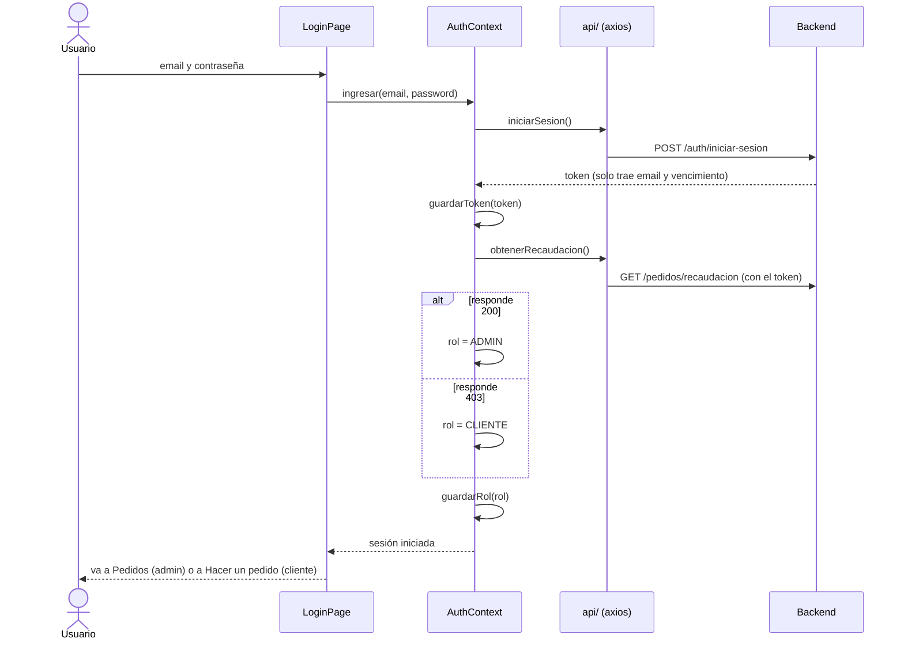
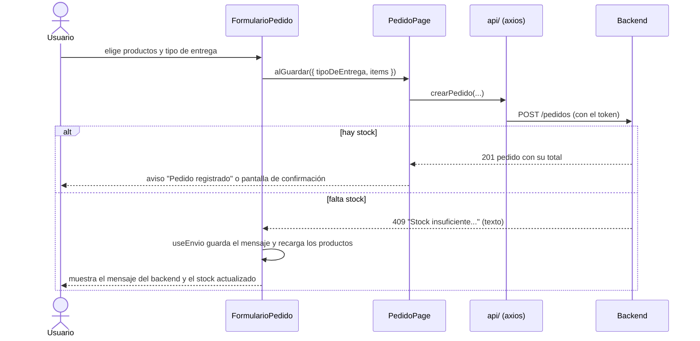

# Frontend de Gutti

Panel web de Gutti hecho con **React + Vite + axios**. Consume la API REST del backend (Spring Boot)
que corre en `http://localhost:8080`. El front no agrega datos ni reglas propias: filtros, cálculos, stock y
validaciones los resuelve el backend, y el front muestra lo que responde.

## Cómo correrlo

Requisitos: **Node 20.19 o más nuevo** y el backend corriendo.

```bash
cd frontend
npm install
npm run dev              # abre en http://localhost:5173
```

En desarrollo, Vite reenvía `/api` al backend (`http://localhost:8080`), así que no hace falta configurar nada.

Los datos de prueba (usuarios y productos) los carga el backend al iniciar; el front no trae datos propios.

| Comando          | Qué hace                                   |
| ---------------- | ------------------------------------------ |
| `npm test`       | Corre las pruebas unitarias (Vitest).      |
| `npm run build`  | Genera la versión para producción.         |
| `npm run lint`   | Revisa errores y reglas con ESLint.        |
| `npm run format` | Formatea el código (líneas de hasta 120).  |

## Qué puede hacer cada usuario

- **Sin cuenta:** ver el catálogo de productos activos (buscar por nombre y filtrar por categoría), crear una cuenta
  e ingresar.
- **Cliente:** hacer un pedido (retiro en el local o delivery; arranca con su nombre y teléfono) y ver o editar su
  perfil (**Mi perfil**).
- **Admin:** ver los pedidos por fecha y tipo con el total vendido, cambiar su estado (entregado o pendiente),
  editar pedidos pendientes, eliminarlos, cargar pedidos de mostrador, administrar los productos (incluidos los
  desactivados) y ver o editar los datos de los clientes.

## Estructura

```
src/
├── api/          ← única capa que habla con el backend (axios en client.js, token guardado en token.js)
├── auth/         ← sesión, detección del rol (rol.js) y rutas protegidas
├── assets/       ← logo y fotos de los productos
├── hooks/        ← useCarga (traer datos), useEnvio (guardar y mostrar el error), useFormulario (campos)
│                   y useProductosActivos (catálogo con filtros del backend)
├── components/   ← piezas de pantalla reutilizables, sin llamadas al backend
├── pages/        ← una pantalla por archivo
├── utils/        ← funciones puras: dominio, pedido (carrito), imágenes, errores, filtros, formato, rutas
├── App.jsx       ← las rutas
├── main.jsx      ← punto de entrada
└── styles.css    ← estilos (claro y oscuro)
tests/            ← pruebas de utils, api, detección del rol, useCarga, RutaProtegida e imágenes
```

- **Responsabilidad única:** cada archivo hace una sola cosa (por ejemplo, `api/pedidos.js` solo
  conoce los endpoints de pedidos).
- **Inversión de dependencias:** las pantallas usan funciones de `api/`, nunca axios directo.
- **Abierto/cerrado:** agregar una entidad = un archivo en `api/` + una página, y registrar su ruta
  (`utils/rutas.js` y `App.jsx`) y su enlace en el menú (`Layout.jsx`). Lo existente no se modifica.
- **Dependencias en un solo sentido:** `pages → components → utils`, `pages → hooks → api` y
  `pages → auth → api → utils`. Los componentes no conocen la capa HTTP ni la sesión: reciben los datos y
  qué hacer al guardar (solo `Layout`, el marco de la app, lee la sesión para armar el menú). `utils/` no
  depende de las otras capas.
- **Sin código repetido:** el envío de formularios (`useEnvio`), los avisos de error de las acciones
  (`useAccionConAviso`), los filtros de productos (`FiltrosProductos`) y el encabezado de cada pantalla
  (`Encabezado`) están escritos una sola vez.

## Cómo se detecta el rol al iniciar sesión



## Cómo se registra un pedido (y qué pasa si falta stock)



## Estándares de código

Siguen el documento de buenas prácticas de la cátedra y las prácticas de Programación Extrema:

- **Mismo estilo para todos:** Prettier formatea y ESLint controla las reglas de la cátedra: llaves en
  todos los `if`, `===`, nada sin usar, archivos de hasta 500 líneas, líneas de hasta 120 y sin
  números mágicos en `src/`.
- **Nombres:** funciones con verbo (`listarPedidos`, `formatearPesos`), componentes con sustantivo,
  constantes en `MAYUSCULAS` y todo en español, igual que el backend.
- **Sin números mágicos:** cada valor fijo tiene nombre (`MILISEGUNDOS_POR_SEGUNDO`, `ROL`, `TIPO_ENTREGA`).
- **Seguridad:** no hay contraseñas, claves ni URLs privadas en el código. `.env` no se sube al repositorio.
- **Comentarios solo cuando aportan:** explican el porqué, no repiten el código.
- **Pruebas junto al código:** `tests/` se corre con `npm test`.

## Notas sobre el backend

- El backend define CORS en `CorsConfig`, pero Spring Security no lo usa (falta `.cors()` en `ConfiguracionSeguridad`):
  el preflight `OPTIONS` de `/pedidos` y `/productos` da 403. Por eso el front llama a `/api` por el proxy de Vite
  (mismo origen) y no depende de CORS.
- El cliente no puede editar su pedido: el backend deja `/pedidos/**` (menos el POST) solo para ADMIN y no tiene un
  endpoint de "mis pedidos". Por eso la edición es solo del admin.
- El pedido no guarda la dirección de entrega: para delivery solo viaja el teléfono. La dirección está en el perfil.
- El backend no guarda imágenes de productos: la foto se elige según una palabra del nombre (`utils/imagenes.js`).
- La respuesta de un pedido no trae el id del producto: al editar, el carrito se arma por nombre de producto.
- El JWT no trae el rol. Al iniciar sesión se prueba `GET /pedidos/recaudacion`: si responde, es
  ADMIN; si da 403, es CLIENTE. El rol solo decide qué pantallas se muestran; la seguridad real la
  pone el backend. Si el backend agrega el rol al token, se reemplaza `detectarRol` por leer ese dato.
- Si el servidor deja de aceptar un token que todavía no venció (por ejemplo, cambió `JWT_SECRET`),
  el backend responde 403 igual que cuando falta permiso, así que el front no lo puede distinguir:
  el mensaje de error indica cerrar sesión y volver a ingresar.
- Las categorías (`utils/dominio.js`) copian el enum `CategoriasEnum` del backend porque no hay un
  endpoint que las liste. Si se agrega una categoría en el backend hay que sumarla ahí.
- `GET /pedidos/recaudacion` suma todos los pedidos del período, también los pendientes. Por eso en
  pantalla se muestra como "Vendido en el período" y no como plata ya cobrada.
- El backend no deja editar productos desactivados, por eso "Editar" se habilita al activarlos.
- `GET /productos/**` es público y devuelve también productos desactivados si se piden. El front solo se los
  muestra al admin (el catálogo y el armado de pedidos piden `estadoActivo=true`), pero restringirlo es tarea del
  backend.
- `LocalDateTime.now()` usa la zona horaria del servidor. En Docker es UTC, así que los pedidos de
  21 a 24 hs quedan con fecha del día siguiente. Se arregla con `TZ=America/Argentina/Buenos_Aires`
  en el servicio `backend` de `docker-compose.yml`.
